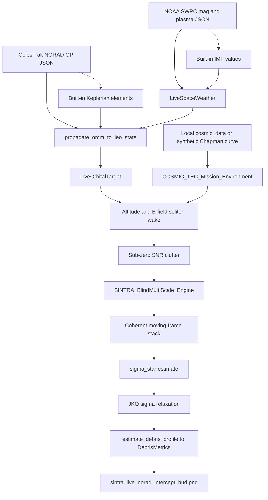
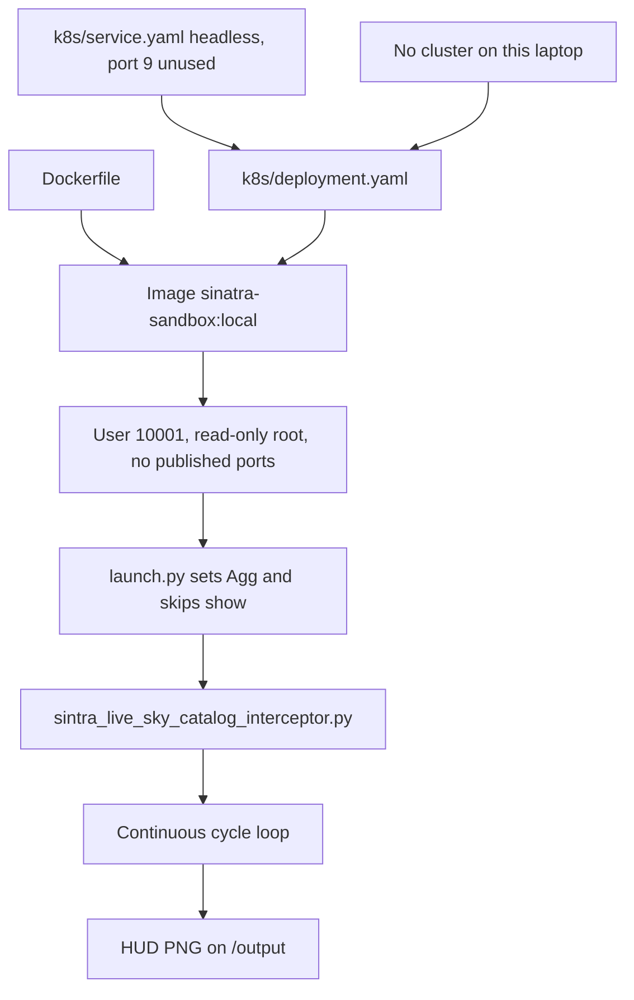

# Sinatra

Private copy of the SINTRA live interceptor, packaged as a local container. The process does not listen on a port. It loops the sky-catalog script and writes a HUD image.

Remote: `git@github.com:code4johnm/sinatra.git` (private).

## How to run

Build the image from this directory:

```bash
docker build -t sinatra-sandbox:local .
```

Run it:

```bash
docker run --rm --name sinatra-live \
  --user 10001:10001 --read-only --cap-drop ALL \
  --security-opt no-new-privileges \
  --pids-limit 128 --memory 4g --memory-swap 4g --cpus 2 \
  --tmpfs /tmp:rw,nosuid,nodev,mode=1777,size=512m \
  -v "$PWD/output:/output" \
  -e MPLBACKEND=Agg -e MPLCONFIGDIR=/tmp/mpl -e HOME=/tmp \
  -w /output sinatra-sandbox:local
```

Create `output/` first. The container writes `sintra_live_norad_intercept_hud.png` there.

Kubernetes manifests are in `k8s/`. They expect the image name `sinatra-sandbox:local` on the same machine (`imagePullPolicy: Never`).

```bash
kubectl apply -f k8s/deployment.yaml -f k8s/service.yaml
```

There is no cluster on this laptop yet. `kubectl apply` does nothing until kubelet is installed.

## Expected output

Each pass prints a cycle line, a catalog of seven objects, and a save line for the HUD PNG. The script then starts the next cycle. The PNG is overwritten each pass.

Live feeds often fall back. NOAA's solar-wind URL can 404, and the script then prints its built-in field values while still saying the stream is live. CelesTrak has a 2.5 second timeout, and a miss uses the built-in Keplerian elements. With no local `cosmic_data` files, the background is the synthetic Chapman curve.

## Architecture

`launch.py` forces the Matplotlib Agg backend and returns immediately from `show()`, so the loop is not blocked by a window. The container command runs `sintra_live_sky_catalog_interceptor.py`. That script's `__main__` calls `run_live_sky_interceptor()` forever and closes figures between cycles.

The image is `python:3.12-slim-bookworm` plus numpy, scipy, sympy, matplotlib, requests, and netCDF4. The user inside the image is uid 10001.

`k8s/deployment.yaml` runs one replica as that uid, with a read-only root filesystem, every capability dropped, and emptyDir volumes on `/tmp` and `/output`. `k8s/service.yaml` is headless. Port 9 is discard and is not served.

## Diagrams

The drawings live in [diagrams/](diagrams/README.md). Each `.mmd` file is the source. GitHub renders the copies below.





## Network

The container does not listen. It uses outbound HTTP on port 80 and HTTPS on port 443 for the public data feeds. If those requests fail, the script uses its built-in values and still writes the HUD image. Git traffic for this repo is SSH on port 22. The host port list is `~/.local/share/network-baseline.md`.

## Operational notes

Stop a local container with `docker stop sinatra-live`. An exited container still holds that name until it is removed.

The repo stays private. Do not force-push. Do not add secrets or `.mil` material.

The HUD and the three checked-in PNG files are pictures of the script's output, not a service endpoint.
