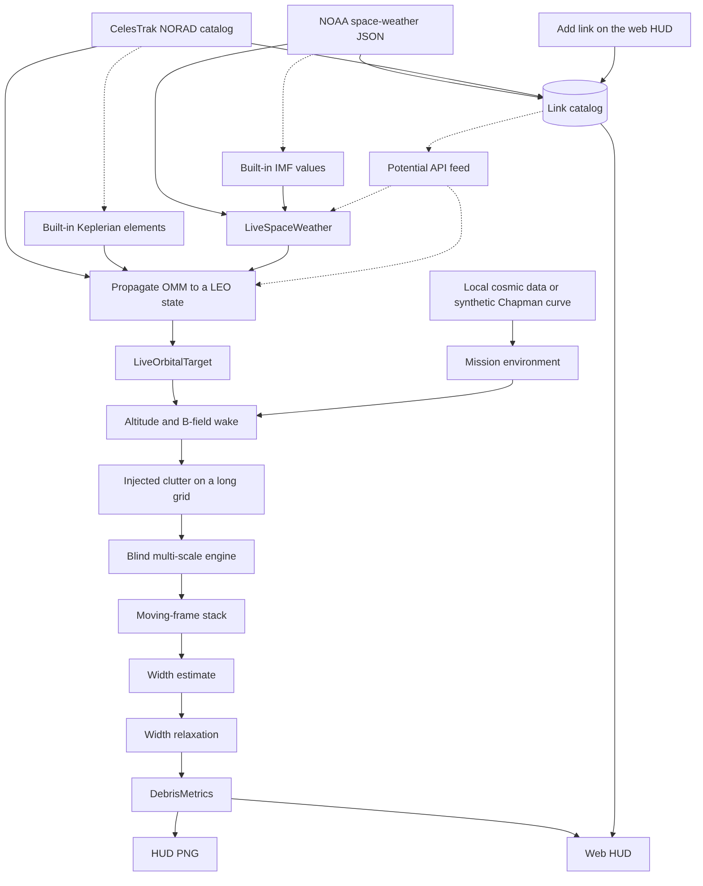
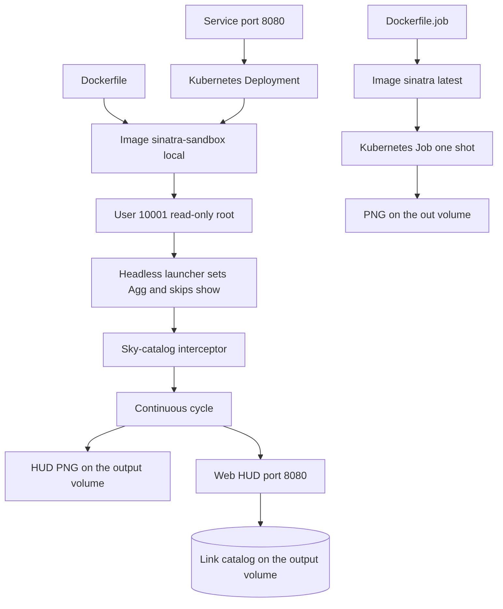
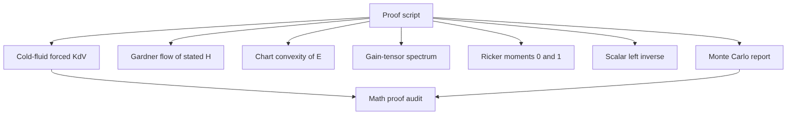

# Sinatra

Separate copy of the SINTRA live interceptor, packaged as a local container. It loops the sky-catalog script, prints the terminal HUD, writes a HUD image, and serves the same cycle on a web HUD at port 8080.

Remote: `git@github.com:code4johnm/sinatra_audit.git`.

## How to run

Build the image from this directory:

```bash
docker build -t sinatra-sandbox:local .
```

Run it with `./run-live.sh`. The container has a read-only root filesystem and every capability dropped. It writes `sintra_live_norad_intercept_hud.png` into the `output/` bind mount. That mount has to be writable by the process uid. Filesystems such as NTFS/fuseblk ignore `chmod`, so a run as uid 10001 fails at `savefig` with `PermissionError: [Errno 13]` after the cycle finishes. The script keeps uid 10001 when that uid can write, and otherwise uses the directory owner.

```bash
./run-live.sh
```

Equivalent steps:

```bash
mkdir -p output
docker run --rm --name sinatra-live \
  --user "$(stat -c '%u:%g' output)" --read-only --cap-drop ALL \
  --security-opt no-new-privileges \
  --pids-limit 128 --memory 4g --memory-swap 4g --cpus 2 \
  --tmpfs /tmp:rw,nosuid,nodev,mode=1777,size=512m \
  -p 8080:8080 \
  -v "$PWD/output:/output" \
  -e MPLBACKEND=Agg -e MPLCONFIGDIR=/tmp/mpl -e HOME=/tmp \
  -e SINTRA_HUD_PORT=8080 \
  -w /output sinatra-sandbox:local
```

The PNG is written in `output/`. The web HUD is `http://127.0.0.1:8080`. It is the same process and the same loop: terminal lines, plus custody, space-weather, and error stats. Set `SINTRA_HUD=0` to skip the page. Kubernetes still runs as uid 10001: its `emptyDir` honors `fsGroup`, unlike this bind mount.

Kubernetes manifests are in `k8s/`. The Deployment runs this checkout, mounted read-only at `/opt/sinatra`. The image `sinatra-sandbox:local` is only the Python runtime (`imagePullPolicy: Never`). The bus listener is not in this pod. See [DEPLOY.md](DEPLOY.md).

## Expected output The web page follows the same lines and updates the active track while the sweep is still running.

Each pass prints a cycle line, a catalog of seven objects, and a save line for the HUD PNG. The script then starts the next cycle. The PNG is overwritten each pass.

Live feeds often fall back. NOAA's solar-wind URL can 404, and the script then prints its built-in field values while still saying the stream is live. CelesTrak has a 2.5 second timeout, and a miss uses the built-in Keplerian elements. With no local `cosmic_data` files, the background is the synthetic Chapman curve.

## Architecture

`launch.py` forces the Matplotlib Agg backend and returns immediately from `show()`, so the loop is not blocked by a window. The container command runs `sintra_live_sky_catalog_interceptor.py`. That script's `__main__` calls `run_live_sky_interceptor()` forever and closes figures between cycles. The same process serves `sintra_web_hud.py` on port 8080. The page is unauthenticated. It shows the terminal log, the latest PNG, dashboard stats from the cycle, a compact process panel, a full-width banner of 24-hour clocks for local time, Zulu, Eastern, GMT, Jerusalem, Tehran, and Tokyo, every IPv4 address plus Docker, Kubernetes, host LAN, and WAN, and the link catalog. Host LAN and WAN come from the wan-ip-checker relay file, the same file the k3s dashboard reads. The page also has an FTP file client: a link box, file boxes, and Open and Save. The FTP server listens on 127.0.0.1 port 2121 and stays inside the output ftp directory. Green means that row is active. Red means it is inactive. Live NOAA and CelesTrak URLs are stored in that catalog. A link added on the page is saved there as a potential feed. The cycle does not request an added URL.

The image is `python:3.12-slim-bookworm` plus numpy, scipy, sympy, matplotlib, requests, and netCDF4. The user inside the image is uid 10001. The web HUD uses the standard library only.

`k8s/deployment.yaml` is held at 0 replicas. The container command is `python /opt/sinatra/launch.py /opt/sinatra/sintra_live_sky_catalog_interceptor.py`, working directory `/output`, uid 10001, read-only root filesystem, every capability dropped. `/opt/sinatra` is hostPath `/mnt/5TB/git/sinatra_audit`. `/tmp` and `/output` are emptyDir. Port 8080 is named `hud` and is a hostPort. `k8s/service.yaml` selects that port. When a replica is running, the page on this laptop is `http://127.0.0.1:8080/`. Deployment `yaml-listen` is the bus listener and is a different workload. Details and the apply command are in [DEPLOY.md](DEPLOY.md).

## Diagrams

Sources are in [diagrams/](diagrams/README.md). GitHub leaves these graphs on Loading, so the pages show the rendered PNG. A slash inside a Mermaid node label is parsed as a shape, which is why the sources avoid slashes.



Dotted edges from the link catalog are potential feeds. The cycle still calls NOAA and CelesTrak. An added link is saved and shown, and the interceptor does not request it.





The web HUD listens on port 8080. The container alsos. It does not prove sub-zero-SNR custody. See [sinatra_math_proof_audit.md](sinatra_math_proof_audit.md).

## Network

The container does not listen. It uses outbound HTTP on port 80 and HTTPS on port 443 for the public data feeds. If those requests fail, the script uses its built-in values and still writes the HUD image. Git traffic for this repo is SSH on port 22.

## Operational notes

Stop a local container with `docker stop sinatra-live`. An exited container still holds that name until it is removed.
three checked-in PNG files are pictures of the script's output. The live web HUD is the page on port 8080. The PNG written each cycle is also shown there
Do not force-push. Do not add secrets or `.mil` material.

The HUD and the three checked-in PNG files are pictures of the script's output, not a service endpoint.

## Batch Job (one run, then exit)

`Dockerfile.job` builds a second image that runs one script once, headless (`MPLBACKEND=Agg`), as uid 10001, and writes its PNG to `/out`.
The default is `sintra_live_mission_demo.py`. It finishes on its own in about 30 seconds and needs no network: without `netCDF4` it uses the synthetic Chapman background.
To pick another script, set `SINTRA_SCRIPT=<file.py>` or pass the file name as the first argument. Those scripts need `sympy`, which this image leaves out, and the interceptor loops forever.

```bash
docker build -f Dockerfile.job -t sinatra:latest .
mkdir -p out
docker run --rm --user "$(stat -c '%u:%g' out)" -v "$PWD/out:/out" sinatra:latest
```

`out/` has the same bind-mount constraint as `output/`. On a filesystem that ignores `chmod`, uid 10001 cannot write the PNG. The `--user` flag above is the directory owner. The Kubernetes Job still uses uid 10001 with an `emptyDir`.

Load the image into a local cluster. The Job uses `imagePullPolicy: IfNotPresent`, so no registry is involved.

```bash
kind load docker-image sinatra:latest     # kind
minikube image load sinatra:latest        # minikube
```

Run it and read the logs:

```bash
kubectl apply -f k8s/job.yaml
kubectl wait --for=condition=complete job/sinatra --timeout=10m
kubectl logs job/sinatra
```

`/out` is an `emptyDir`, so the PNG is deleted along with the pod, and `ttlSecondsAfterFinished: 3600` removes the Job an hour after it finishes.
