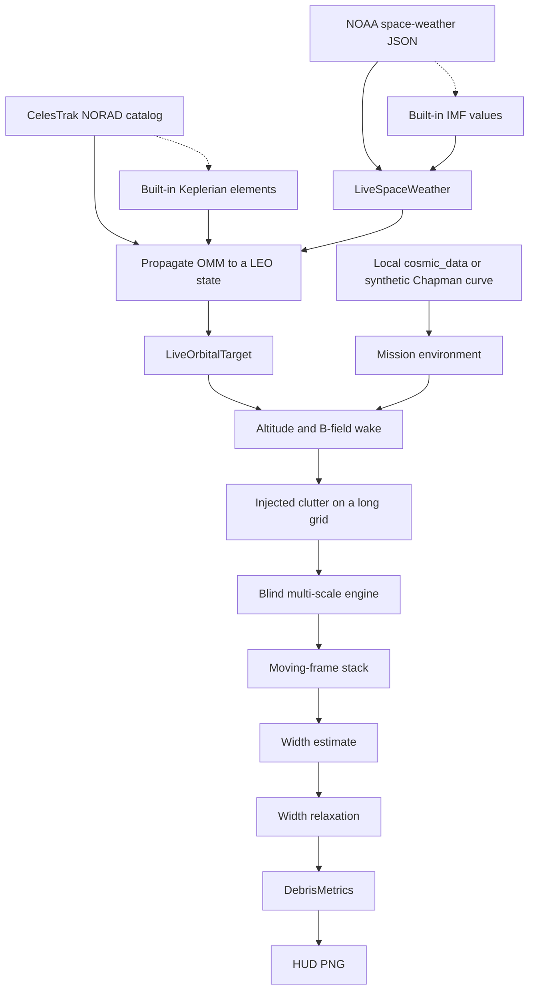
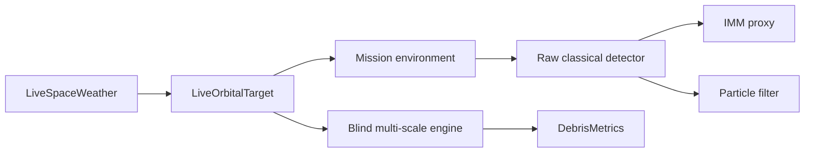
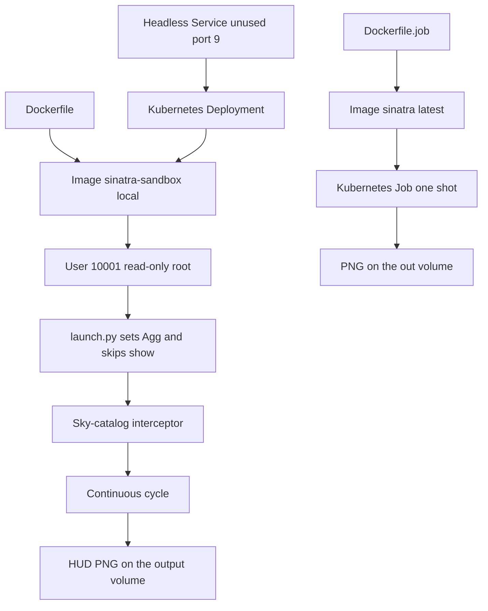

# Sinatra diagrams

These drawings document the live interceptor and the proof-script checks. They do not change runtime behavior.

Labels avoid slashes and parentheses. Mermaid treats a slash inside a node as a shape delimiter, which is why the previous copies failed to render.

## Files

| File | Drawing |
| --- | --- |
| [overview.mmd](overview.mmd) | One intercept cycle |
| [architecture.mmd](architecture.mmd) | Live-script components |
| [data-flow.mmd](data-flow.mmd) | One object, from catalog JSON to DebrisMetrics |
| [deployment.mmd](deployment.mmd) | Container image and Kubernetes manifests |
| [proof-claims.mmd](proof-claims.mmd) | What the proof script checks |

## Cycle

## Components

## Deployment

