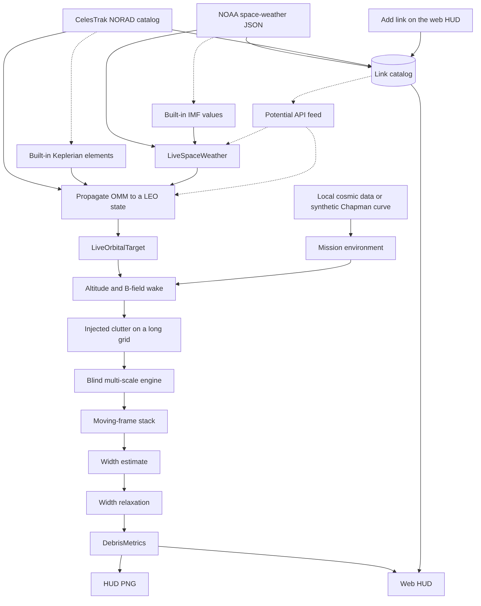
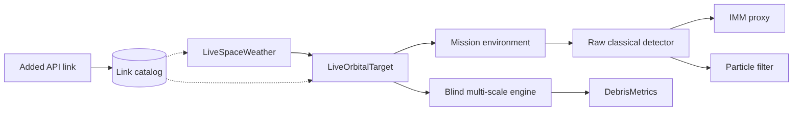
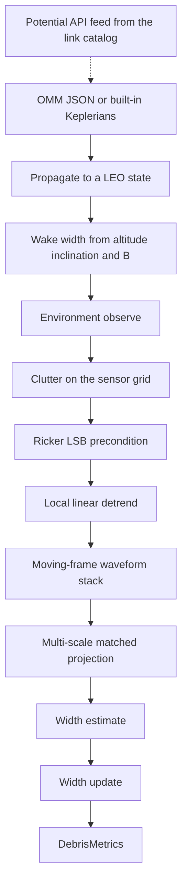
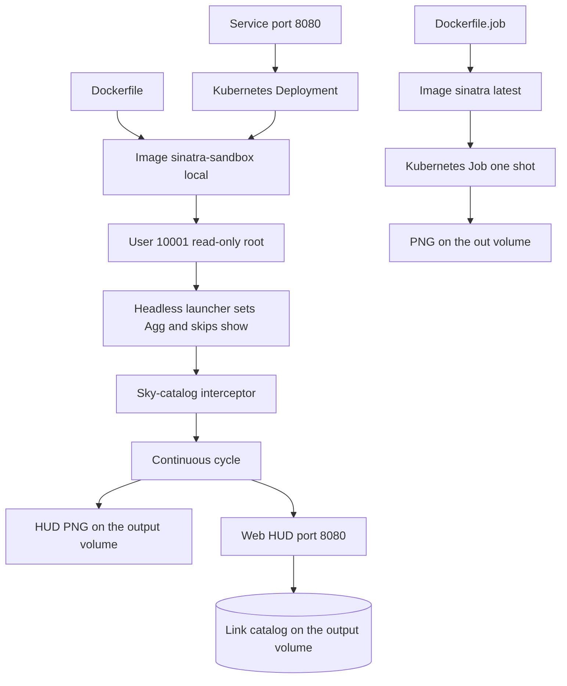
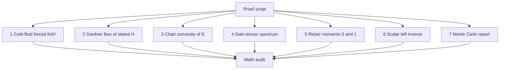
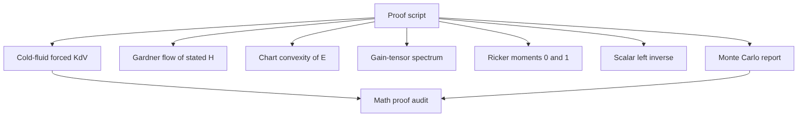
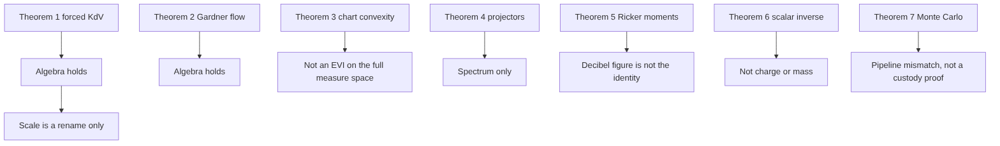
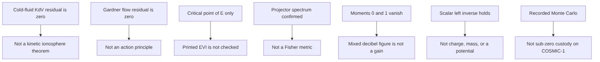

# Sinatra diagrams

These drawings document the live interceptor and the proof-script checks. They do not change runtime behavior.

The `.mmd` files are the sources. The PNGs are what the pages show. GitHub leaves a Mermaid fence on Loading for these graphs. A slash inside a node label is parsed as a shape, so the sources avoid slashes.

## Files

| Source | Picture | Drawing |
| --- | --- | --- |
| [overview.mmd](overview.mmd) | [overview.png](overview.png) | One intercept cycle |
| [architecture.mmd](architecture.mmd) | [architecture.png](architecture.png) | Live-script components |
| [data-flow.mmd](data-flow.mmd) | [data-flow.png](data-flow.png) | One object, from catalog JSON to DebrisMetrics |
| [deployment.mmd](deployment.mmd) | [deployment.png](deployment.png) | Container image and Kubernetes manifests |
| [proof-claims.mmd](proof-claims.mmd) | [proof-claims.png](proof-claims.png) | What the proof script checks |
| [proof-audit.mmd](proof-audit.mmd) | [proof-audit.png](proof-audit.png) | README subset of those checks |
| [proof-summary.mmd](proof-summary.mmd) | [proof-summary.png](proof-summary.png) | Audit section 3 summary |
| [proof-verdict.mmd](proof-verdict.mmd) | [proof-verdict.png](proof-verdict.png) | Audit section 4.10 verdict |

## Cycle

Dotted edges from the link catalog are potential feeds. The cycle still calls NOAA and CelesTrak. An added link is saved and shown, and the interceptor does not request it.

## Components

## Data flow

## Deployment

## Proof script

