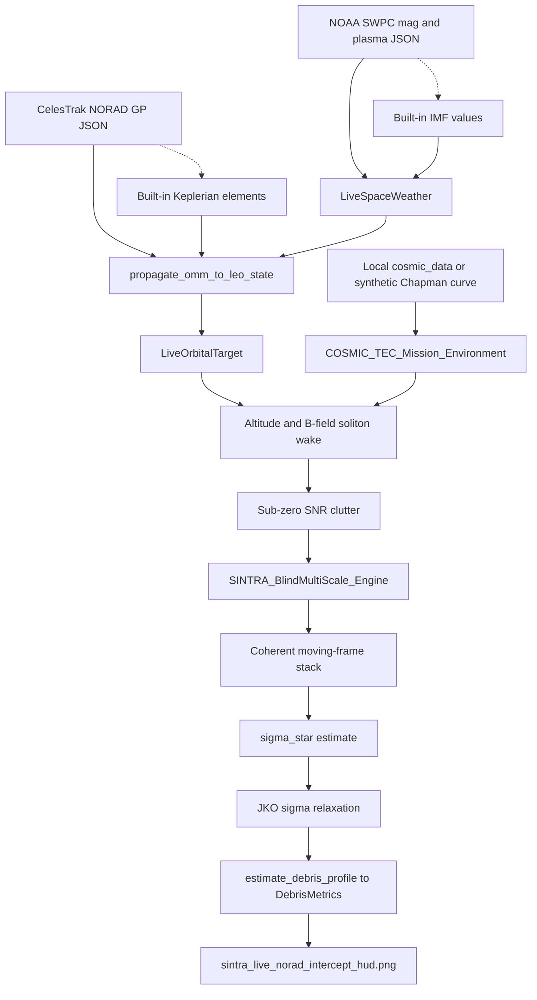
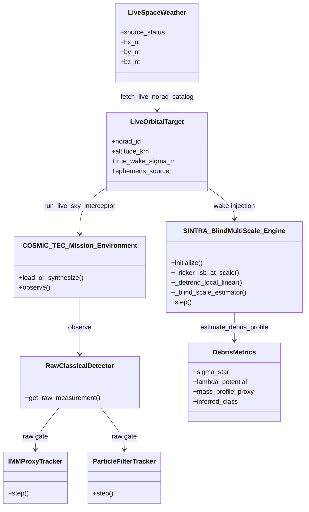
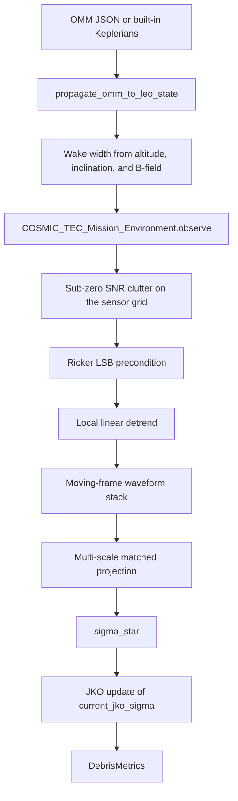
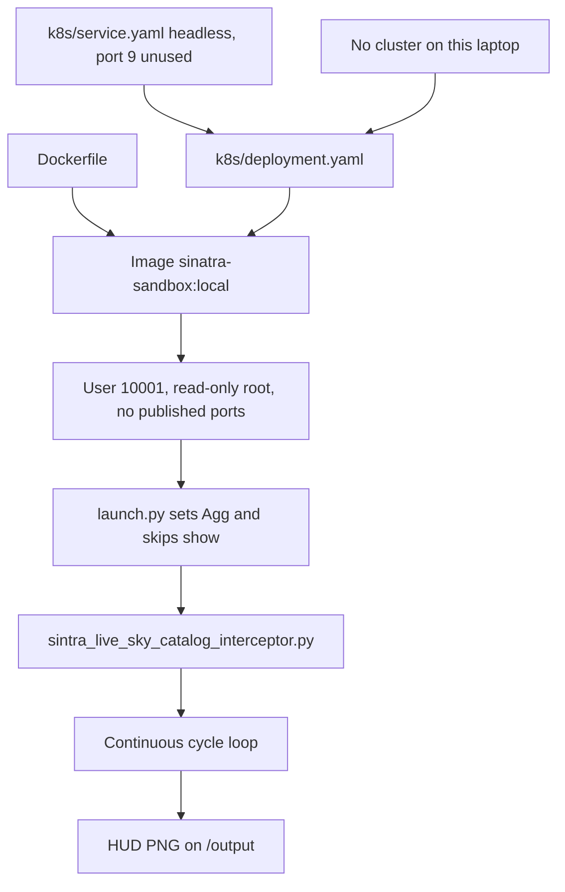

# Sinatra diagrams

These files document the live interceptor. They do not change its behavior. The catalog entry points here. This directory holds the architecture drawings.

## 1. Role

The diagrams show how the private Sinatra container fetches public feeds, runs one intercept cycle, and writes a HUD image.

## 2. Project

- Name: Sinatra live interceptor
- Purpose: Loop `sintra_live_sky_catalog_interceptor.py` in a headless container.
- Tech stack: Python 3.12, Docker, Kubernetes manifests. No cluster is installed on this laptop.

## 3. Compliance

None stated in the repo.

## 4. Scope of work

One cycle fetches NOAA space weather and a CelesTrak catalog, builds a COSMIC-1 or synthetic background, runs the blind multi-scale engine, and saves `sintra_live_norad_intercept_hud.png`. Failed feeds use the built-in values.

## 5. Documentation and deliverables

| File | Drawing |
| --- | --- |
| [overview.mmd](overview.mmd) | End-to-end flow |
| [architecture.mmd](architecture.mmd) | Classes in the live script |
| [data-flow.mmd](data-flow.mmd) | One object, from OMM JSON to DebrisMetrics |
| [deployment.mmd](deployment.mmd) | Image, `launch.py`, and the Kubernetes manifests |

## 6. Architecture

