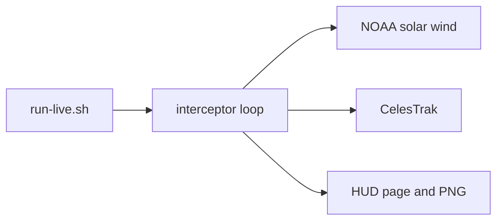

# Architecture

## Contents

- [Process](#process)
- [Data flow](#data-flow)

## Process

The container command is `launch.py` running `sintra_live_sky_catalog_interceptor.py`. The same process serves `sintra_web_hud.py` on port 8080. `run-live.sh` is the host CLI. No second dashboard was added.

## Data flow

A failed fetch uses the script's built-in field values. That fallback already exists. This package does not add a switch.
