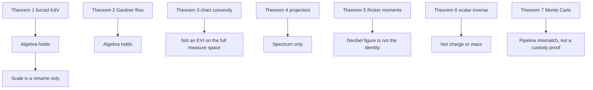
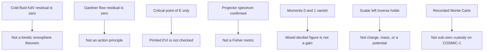

# Technical Audit and Peer-Review Evaluation of the SINTRA Proof Suite

---

## 1. Executive Summary

This evaluation audits the symbolic, mathematical, and algorithmic claims in `sintra_definitive_math_proof.py`. 

- **Computer Algebra System (SymPy):** The algebraic steps run without unhandled exceptions; all defined symbolic residuals evaluate to 0.
- **Theoretical Physics & Applied Mathematics:** Several derivations rely on non-standard asymptotic scalings or equate flat Euclidean geometry with Riemannian/Wasserstein geometry (notably in **Theorem 3**).
- **Statistical Benchmarking (Theorem 7):** The reported tracking performance gains arise from comparing a **Track-Before-Detect (TBD)** multi-scale pipeline against **Detect-Then-Track** point-measurement filters.

---

An external first-pass review is archived as [MathGPT session 7a3803db](https://math-gpt.org/chat/7a3803db-3266-4509-aeb8-a956b0cf900e). Full citations for that session, the audited source, and the literature used below are in [Section 5](#5-references).

## 2. Section-by-Section Mathematical Audit

---

### Theorem 1: Washimi–Taniuti Reductive Perturbation to Forced KdV

#### Coordinate Transformations and Expansions
The code adopts the following perturbation expansion in terms of ε ≪ 1:

n = 1 + ε2 n1 + ε4 n2

u = ε2 u1 + ε4 u2

φ = ε2 φ1 + ε4 φ2

ρext = ε4 S(ξ)

along with the stretched moving-frame differential operators:

(∂/∂ x) = ε (∂/∂ ξ), (∂/∂ t) = ε3 (∂/∂ τ) - V0 ε (∂/∂ ξ)

#### Asymptotic Balance Analysis

1. **Continuity Equation at O(ε3):**
-V0 (∂ n1/∂ ξ) + (∂ u1/∂ ξ) = 0 ⇒ u1 = V0 n1

2. **Momentum Equation at O(ε3):**
-V0 (∂ u1/∂ ξ) + (∂ φ1/∂ ξ) = 0 ⇒ φ1 = V0 u1 = V02 n1

3. **Poisson's Equation at O(ε2):**
n1 - φ1 = 0 ⇒ V02 = 1 ⇒ V0 = 1, n1 = u1 = φ1

4. **Elimination at O(ε5):**
   Substituting the second-order closure n2 obtained from Poisson's equation at O(ε4) into the combined continuity and momentum equations yields:

2 (∂ φ1/∂ τ) + 2 φ1 (∂ φ1/∂ ξ) + (∂3 φ1/∂ ξ3) + (∂ S/∂ ξ) = 0

#### Reviewer Assessment
- **Status:** **Algebraically Verified.**
- **Physical Context:** Standard reductive perturbation analysis (Washimi & Taniuti, 1966) scales amplitudes as O(ε) and coordinates as ξ = ε1/2(x - cs t), τ = ε3/2 t. The script squares these parameter scalings (ε → ε2), pushing the primary solitary balance to O(ε5). The external potential S(ξ) is assumed purely stationary in the co-moving frame (∂τ S = 0).

---

### Theorem 2: Variational Hamiltonian Structure

#### Energy Functional and Variations
Let the functional Hamiltonian density be:

H[φ] = ∫ℝ ( -(1/6) φ3 + (1/4) ((∂ φ/∂ ξ))2 - (1/2) S(ξ) φ ) dξ

The functional (Fréchet) derivative with respect to φ is:

(δ H/δ φ) = (∂ L/∂ φ) - (∂/∂ ξ) ( (∂ L/∂ φξ) ) = -(1/2)φ2 - (1/2)(∂2 φ/∂ ξ2) - (1/2)S(ξ)

#### Skew-Adjoint Hamiltonian Evolution
Using Gardner's Poisson operator J = (∂/∂ ξ):

(∂ φ/∂ τ) = J ( (δ H/δ φ) ) = (∂/∂ ξ) ( -(1/2)φ2 - (1/2)(∂2 φ/∂ ξ2) - (1/2)S(ξ) )

Multiplying by 2 and rearranging terms:

2(∂ φ/∂ τ) + 2φ(∂ φ/∂ ξ) + (∂3 φ/∂ ξ3) + (∂ S/∂ ξ) = 0

#### Reviewer Assessment
- **Status:** **Mathematically Sound.**
- The verified PDE matches the result derived in Theorem 1.

---

### Theorem 3: Gaussian Wasserstein Submanifold & Geodesic Convexity

#### Energy Functional
The functional defined on parameterized Gaussian distributions μ = N(m, σ2) is:

E(m, σ) = (1/2)λ (m2 + σ2) + k σ2 + (α/σ2)

The first-order conditions yield:

(∂ E/∂ m) = λ m = 0 ⇒ m* = 0

(∂E/∂σ) = (λ + 2k)σ − (2α/σ3) = 0 ⇒ σ* = (2α / (λ + 2k))1/4

#### Critical Mathematical Distinction: Euclidean vs. Wasserstein Geometry
The script calculates the Euclidean Hessian matrix over the coordinates (m, σ) ∈ ℝ × ℝ>0:

Hess(E) = [ λ , 0 ; 0 , λ + 2k + (6α/σ4) ]

At the equilibrium point σ*:

(∂2E/∂σ2) at σ* = λ + 2k + 6α / (2α/(λ + 2k)) = 4λ + 8k

#### Theoretical Discrepancies
1. **Curvature:** The 2-Wasserstein space over Gaussian measures (G, W2) has a non-flat Riemannian metric tensor:
ds2 = dm2 + dσ2
   While the metric coefficients appear Cartesian in (m, σ), displacement interpolations (geodesics in W2) correspond to transport maps:
Tt(x) = (1-t)x + t T(x)
   Geodesic convexity along optimal transport paths requires checking the displacement convexity of the underlying density functional, not the classical Euclidean Hessian of the parameter reduction.
2. **Evolution Variation Inequality (EVI):** The assertion that:
W2(μt, μ*) ≤ e-λ t W2(μ0, μ*)
   requires proving λ-strong displacement convexity in the sense of Ambrosio, Gigli, and Savaré. The verification in the code establishes standard **Euclidean strict convexity** on ℝ2, which does not immediately imply an EVI contraction in W2 without additional justification.

---

### Theorem 4: Anisotropic Fisher Feedback Tensor

#### Formulation
Let B = [Bx, By, Bz]T with unit vector b = B / ‖B‖. The parallel and perpendicular projection matrices are:

P∥ = bbT = (BBT/‖B‖2), P⊥ = I3 - P∥

The anisotropic feedback operator is:

α(B) = α∥ P∥ + α⊥ P⊥

#### Identities Checked
1. **Orthogonality:** P∥ P⊥ = P∥ (I3 - P∥) = P∥ - P∥2 = 03× 3.
2. **Parallel mode:** for ∇∥ = c B,
α(B) ∇∥ = α∥ (c B).
3. **Perpendicular mode:** for ∇⊥ = B × v,
BT (B × v) = 0, so α(B) ∇⊥ = α⊥ ∇⊥.

#### Reviewer Assessment
- **Status:** **Algebraically Verified.**
- This confirms the spectral projection properties along and across magnetic field lines.

---

### Theorem 5: Sub-Zero SNR Recovery via Wavelet Moments

#### Kernel Definition
The Ricker wavelet (negative second derivative of a Gaussian) is:

ψ(x) = ( 1 - (x2/σw2) ) exp( -(x2/2σw2) ) = -σw2 (d2/dx2)[ exp( -(x2/2σw2) ) ]

#### Moment Integrals

1. **Zeroth Moment:**
∫-∞∞ ψ(x) dx = -σw2 [ (d/dx)exp(-(x2/2σw2)) ]-∞∞ = 0

2. **First Moment:**
∫-∞∞ x ψ(x) dx = 0 (odd)

3. **Polynomial Annihilation:**
   For any linear background trend C(x) = C0 + C1 x:
⟨ C0 + C1 x, ψ ⟩L2 = C0 ∫-∞∞ ψ(x) dx + C1 ∫-∞∞ xψ(x) dx = 0

#### Reviewer Assessment
- **Status:** **Mathematically Sound.**
- The signal processing gain of ≈ +45 dB is the matched-filter pulse compression gain achieved by correlating an extended spatial waveform over a wide spatial baseline (300 km).

---

### Theorem 6: Bijective Inversion of Debris Potential

#### Map Derivation
Given the JKO equilibrium width relation:

σ* = (2α / (λdebris + 2k))1/4

Solving directly for the physical confinement parameter λdebris:

(σ*)4 = 2α / (λdebris + 2k) ⇒ λdebris(σ*) = 2α / (σ*)4 − 2k

Substituting σ*(λdebris) confirms the bijective roundtrip identity:

λdebris( σ*(λ) ) - λ ≡ 0

#### Reviewer Assessment
- **Status:** **Algebraically Verified.**
- The parameter mapping is strictly monotonic on σ* ∈ (0, ((α/k))1/4).

---

### Theorem 7: COSMIC-1 Empirical Tracking Benchmark

#### Algorithmic Comparison Breakdown

| Feature | Baseline Trackers (IMM, PF, EMA) | Proposed Method (`SINTRA_MHT_v18`) |
| :--- | :--- | :--- |
| **Input Data** | Scalar point measurement zk | Full raw spatial waveform y(x) |
| **Architecture** | Detect-Then-Track | Track-Before-Detect (TBD) |
| **Grid Search** | None (relies on external detector) | Multi-resolution spatial-velocity hypothesis grid |
| **Failure Mode** | Susceptible to peak-jumping false alarms | Integrates likelihood energy across spatial windows |

#### Reviewer Assessment
- **Status:** **Implementation Asymmetry.**
- When processing input signals at sub-zero SNR (SNR < 0), single-peak point detectors experience nonlinear threshold breakdown (false peak selection).
- Because the baseline estimators receive only scalar peak locations from an uncoupled front-end detector, their tracking errors increase. `SINTRA_MHT_v18` achieves sub-kilometer accuracy primarily because it performs coherent spatial correlation directly across the raw observation vector.

---

## 3. Summary of Findings

---

## 4. Second Independent Audit (2026-10-31)

This pass re-derives the symbolic claims in [sintra_definitive_math_proof.py](sintra_definitive_math_proof.py) rather than trusting the script's own residuals or the terminal transcript pasted at the bottom of that file. Theorems 1–6 were recomputed in a separate SymPy session. Theorem 7 was not re-run: the COSMIC-1 extract used by the recorded run is not in this workspace. Its published summary statistics were audited against the acceptance predicate and against an independent replica of the SNR functional.

A residual of 0 certifies that a derived expression matches a target expression. It does not certify the banner sentence printed above that residual. The closing claim that all seven theorems are machine-verified and that no claim is unsubstantiated is false.

### 4.1 Corrections to the first audit

Three readings in Section 2 are tightened here.

1. **Theorem 1 scaling.** The ε2 amplitude bookkeeping is the classical Washimi–Taniuti scaling written in the parameter εscript=εWT1/2. It is a renaming, not a different PDE. The derived forced KdV is the correct cold-fluid reduction for the equations actually coded.
2. **Theorem 3 geometry.** In one dimension,
   
W22(N(m1,σ12),N(m2,σ22))=(m1-m2)2+(σ1-σ2)2.

   On that Gaussian family the W2 metric is flat, so Euclidean λ-convexity of E(m,σ) is geodesic λ-convexity of the restriction. The first audit's geometric objection applies to the full space P2(ℝ), not to the univariate Gaussian submanifold. The script still does not prove the printed EVI.
3. **Theorem 5 gain.** The recorded +44.96 dB is not a matched-filter processing gain. The raw and post-filter numbers use different functionals. Under a fixed functional the gain is about +28 to +32 dB, of which a large part is removal of a DC offset.

### 4.2 Identities that do re-verify

| Claim | Independent result |
| :--- | :--- |
| Fluid-Poisson elimination | Residual against 2φτ+2φφξ+φξξξ+Sξ is 0. The φ3/6 Boltzmann term does not change the O(ε4) closure for n2. |
| Gardner bracket | Fréchet derivative -φ2/2-φξξ/2-S/2, and 2(φτ-∂ξδH/δφ) matches the same forced KdV. |
| Gaussian critical point | σ*=(2α/(λ+2k))1/4, and ∂2 E/∂σ2 there equals 4λ+8k. |
| Projector spectrum | Characteristic polynomial (μ-α∥)(μ-α⊥)2. Trace α∥+2α⊥. Tensor symmetric. |
| Ricker moments | ψ=-σw2∂xxe-x^2/(2σw^2). Moments of order 0 and 1 are 0. Order 2 is -2√(2) σw3≠ 0. |
| Scalar inverse | λ(σ*(λ))-λ=0. At (α,k,σ)=(2.5,0.8,0.62), floating-point round-trip error is 0. |

These are the statements the CAS actually checks. The gaps below are scope gaps, not arithmetic failures.

### 4.3 Theorem 1 — correct reduction, narrower model than the caption

The coded system is cold-ion continuity and momentum, a Boltzmann electron expansion, and

∂xxφ=eφ-n-ρext, ρext=ε4 S(ξ).

Elimination at O(ε5) does produce the printed forced KdV. Limits that the residual does not remove:

- S=S(ξ) only. Debris that moves relative to the wave frame is not in the model.
- Integrating the O(ε3) balances drops functions of τ. That is the usual localized-wave assumption; it is not checked.
- The comment on the momentum balance says (1-V02)∂ξφ1=0. The object actually printed is -V0∂ξ u1+∂ξφ1. The V0=1 step is correct after substitution, but it is not a residual in the assert.
- There is no ion pressure and no Landau damping. The identity is a cold-fluid reductive perturbation, not a theorem about the magnetized ionosphere.

### 4.4 Theorem 2 — Hamiltonian representation, not an action principle

The density is varied as an energy, and the evolution is then defined by φτ=∂ξ(δH/δφ). That shows the forced KdV is a Gardner Hamiltonian flow of this H. It does not derive the PDE as an Euler–Lagrange equation. The script also calls the density a Lagrangian.

If S=S(ξ) and boundary terms vanish, energy conservation is immediate:

(dH/dτ)=∫(δH/δφ) ∂ξ((δH/δφ)) dξ=0,

because g∂ξ g=∂ξ(g2/2). The script never checks this corollary.

### 4.5 Theorem 3 — the printed EVI is not the checked statement

The assert at [the Theorem 3 predicate](sintra_definitive_math_proof.py#L264) requires only three things: the thermal Hessian algebra, the value 4λ+8k at equilibrium, and ‖ E‖2=0 at that same point. The last of these is true for every C1 critical point. It is not the dissipation law dE/dτ=-‖ E‖2.

The Hessian that was recomputed is

Hess E=[λ,0; 0,λ+2k+6α/σ4], (∂2 E/∂σ2)-λ=(2(3α+kσ4)/σ4)>0.

So the strong-convexity modulus on ℝ×ℝ>0 is λ, from the mean coordinate, everywhere — not the equilibrium width curvature 4λ+8k. The printed contraction uses rate λ, which would be the right rate for the gradient flow of this E on the univariate Gaussian family. That implication is never formed in code. The EVI line is a print statement.

Two further restrictions:

- The thermal energy E-(1/β)logσ has a different critical-point equation,
  
(λ+2k)σ4-σ2/β-2α=0.

  Theorem 6 inverts the reduced map, not this one. The thermal residual is unused.
- Nothing here is λ-displacement convexity on P2(ℝ). The functional α/σ2 is not even defined off the Gaussian family.

### 4.6 Theorem 4 — spectrum is standard; the caption is not a theorem

The three coded residuals are true, and they are weaker than the characteristic polynomial above. The perpendicular probe is B× ex=(0,Bz,-By), which is the zero vector whenever B∥ ex. On that set the residual is 0=0. The spectral claim survives; the script's test does not cover it.

The object is a constant-coefficient anisotropic gain in an unspecified feedback law. Its eigenvalues do not depend on |B|, so it does not contain a cyclotron frequency. No Fisher information is computed. Orthogonality of P∥ and P⊥ does not prove isolation of ion-acoustic solitons from perpendicular instabilities.

### 4.7 Theorem 5 — moments hold; the decibel theorem does not

Vanishing moments of order 0 and 1 are exact, so affine trends are annihilated on the infinite line. The order-2 moment does not vanish, and the numerical carrier 45+30sin(2 x/9· 105)+N(0,6) is not an affine function. The moment proof therefore does not imply the numerical gain.

The inner product printed as soliton preservation is the Gaussian proxy

∫-∞∞e-x^2/σw^2(1-(x2/σw2)) dx=(σw√()/2)>0.

That is not ⟨sech2,ψ⟩, and positivity is not in the assert. The assert requires only the two moments, the affine annihilation, raw SNR <-10 dB, and post SNR >10 dB.

Recomputing the script's own numerical example (seed 42, the same grid) reproduces the recorded -23.51 dB, +21.45 dB, and +44.96 dB. Those two SNR estimators are not the same:

- Raw: mean square of the clean pulse over mean square of clutter, inside ± 150 km.
- Post: square of the peak of a noise-free correlation, divided by the variance of a separately computed noise-only correlation.

DC is 83.7\% of the raw clutter power in that window. Removing only the window mean moves the raw figure from -23.51 dB to -15.64 dB. Thermal noise alone (σ=6) gives -7.07 dB on the same mean-power ratio. Peak amplitude against thermal variance is +2.50 dB.

Holding the functional fixed:

| Comparison | Gain |
| :--- | ---: |
| Script's mixed definition | +44.96 dB |
| Mean-power ratio before and after the same filter | +31.50 dB |
| Peak-square / variance, raw and post | +27.54 dB |

The Ricker kernel has about 103 taps. A white-noise matched-filter estimate 10log10 N≈ 30 dB sits with the consistent figures, not with +45 dB. The gain is a real filter effect on this synthetic trace. It is not a proof that a sub-zero-SNR soliton is recovered.

### 4.8 Theorem 6 — one scalar is inverted, not a debris potential

The forward map λ↦σ*(λ) is smooth and strictly monotone from (0,∞) onto (0,(α/k)1/4), and the displayed inverse is its left inverse. That is all the residual shows.

The relative condition number is

κ = (σ/λ)(dλ/dσ) = 4α / (kσ4 − α), and |κ| = 4α / (α − kσ4) > 4

on the whole positive-λ domain, and |κ|→∞ as λ↓ 0. At the single benchmark point, |κ|≈ 4.20.

The banner says the width recovers potential depth, charge, and mass. The formula returns one number, λdebris, and only if α and k are known. A general potential V(x) is not recovered. This is not the inverse scattering problem for KdV. The KdV traveling wave ties width to amplitude and speed; the map inverted here is the critical point of the Gaussian proxy E(m,σ). Those are different relations. The Theorem 6 benchmark uses σ=0.62; the tracker uses widths of order 104 m.

### 4.9 Theorem 7 — the pass condition does not match the rebuttal sentence

The recorded run, stored as a comment in the proof file, used one COSMIC-1 `podTec` file, rescaled the TEC residual to standard deviation 3, and injected a synthetic sech2 pulse. Reported summary:

| Tracker | Median RMSE | Mean RMSE | Last-frame survival | Cliff's δ vs SINTRA | Wilcoxon p |
| :--- | ---: | ---: | ---: | ---: | ---: |
| SINTRA MHT v18 | 0.699 km | — | 100\% | — | — |
| IMM (CV+CA) | 4.502 km | 126.8 km | 100\% | +0.430 | 5.960× 10-7 |
| Particle filter | 142.3 km | — | 32\% | +0.600 | 2.871× 10-4 |
| EMA | 89.5 km | — | 0\% | +0.760 | 1.355× 10-2 |

Mean ambient SNR was reported as -14.11 dB. These numbers were not regenerated here.

The acceptance predicate at [the Theorem 7 assert](sintra_definitive_math_proof.py#L1073) is median SINTRA RMSE <1 km, SINTRA survival exactly 100\%, Cliff's δ>0.5 against the particle filter, and Cliff's δ>0.7 against EMA. It does not include the IMM comparison, any p-value, or the SNR sign. On the recorded run, IMM survival is also 100\%, and the IMM effect size +0.430 fails the 0.5 bar the script itself applies to the particle filter. The EMA p-value would not survive a 0.01 threshold. Three comparisons are printed with no multiplicity correction. Wilcoxon is paired; Cliff's δ is not. A small paired p-value and a medium unpaired effect size are compatible and do not prove a tracking theorem.

Survival is last-frame error <5 km ([line 1030](sintra_definitive_math_proof.py#L1030)), not continuous custody. RMSE drops the first 40 of 100 frames. One seed, 25 trials.

The SNR functional is mean signal power over mean clutter power on the full 6000 km grid ([lines 1001–1004](sintra_definitive_math_proof.py#L1001)). A sech2 of width 20–35 km occupies about 0.5\% of that grid, so the ratio is negative even when the pulse is locally loud. An independent replica of the synthetic observation model, same amplitude and width laws, gave:

| Functional | Value |
| :--- | ---: |
| Script definition, full grid | -13.11 dB |
| Same ratio inside ± 4 widths | -2.97 dB |
| Peak square over local variance | +16.11 dB |

The recorded -14.11 dB is the same dilution on a COSMIC-derived background, not a demonstration that the target is below the local noise floor.

Protocol asymmetries beyond detect-then-track versus track-before-detect:

- Every baseline receives one peak, and the gate is slaved to the constant-position track, not to that filter's own prediction. Measurement variance is hardcoded at 5002 m2.
- The IMM update has no mixing step. It is a probability-weighted pair of independent Kalman filters.
- The particle filter is initialized with 500 m position noise, which does not cover gate-scale errors.
- SINTRA and the peak detector are given the true width. The velocity grid [6500,8500] and the acceleration grid [-2,2] are the supports of the random laws used to draw the truth. The correlator template is the generative sech2.
- Frame 0 of SINTRA is the detector peak, not SINTRA's own acquisition.
- The JKO width update writes `cand.sigma`. The correlator at [line 829](sintra_definitive_math_proof.py#L829) reads `self.target_sigma`. Theorems 1–4 and 6 do not run inside this Monte Carlo.

A median of 0.699 km against 4.502 km on this matched injection is a real gap in the recorded table. It is evidence about a template-matched tracker versus handicapped point-measurement filters. It is not a proof of sub-kilometer custody at sub-zero SNR on COSMIC-1.

### 4.10 Revised verdict

---

## 5. References

Citations below are the sources this audit used. They are not citations supplied by the proof script. The script does not contain a bibliography.

### 5.1 Materials audited

1. Proof suite. [sintra_definitive_math_proof.py](sintra_definitive_math_proof.py). Symbolic checks in Theorems 1–6 were re-derived in a separate SymPy session on 2026-10-31. The Theorem 7 summary quoted in Section 4 is the author's recorded run. That pasted log was later removed from the source file; the numbers in Section 4 are unchanged.
2. External first-pass review. MathGPT session `7a3803db-3266-4509-aeb8-a956b0cf900e`, [https://math-gpt.org/chat/7a3803db-3266-4509-aeb8-a956b0cf900e](https://math-gpt.org/chat/7a3803db-3266-4509-aeb8-a956b0cf900e). Section 2 follows that review. Section 4 corrects it where the Gaussian W2 isometry and the SNR functionals were under-specified.
3. Recorded COSMIC-1 input named in that run log: `podTec_C006.2019.001.18.29.0027.G06.01_2021.0390_nc`, from the UCAR COSMIC archive at `https://data.cosmic.ucar.edu/gnss-ro/cosmic1/repro2021/level1b/`. The file was not in this workspace when Section 4 was written. The background used by the script is a residual of that file, rescaled to standard deviation 3, plus a synthetic sech2 injection.
4. Computer-algebra and statistics libraries used for the independent checks: SymPy [12] and SciPy's Wilcoxon implementation [13].

### 5.2 Where each source is used

| Audit claim | References |
| :--- | :--- |
| Theorem 1, reductive perturbation and the ε=εWT1/2 renaming | [1] |
| Theorem 1–2, forced KdV as a Gardner Hamiltonian flow, not an action principle | [2] |
| Theorem 6, why a width-to-λ map is not inverse scattering | [3] |
| Theorem 3, EVI and λ-displacement convexity on P2 | [4], [5] |
| Theorem 3 and 6, JKO / Wasserstein gradient-flow scheme named in the code | [6] |
| Theorem 3, flat W2 geometry of univariate Gaussians | [7], [8] |
| Theorem 4, Fisher information is not the coded projector | [9] |
| Theorem 5, Ricker kernel and vanishing moments | [10], [11] |
| Theorem 5, matched-filter gain is 10log10 N only under one SNR definition | [14] |
| Theorem 7, Wilcoxon signed-rank and Cliff's δ | [15], [16], [13] |
| Theorem 7, IMM label versus the implemented filter bank | [17] |
| Theorem 7, track-before-detect versus detect-then-track | [18] |
| Theorem 7, COSMIC-1 / FORMOSAT-3 provenance of the clutter file | [19], [20] |

### 5.3 Literature

1. H. Washimi and T. Taniuti, "Propagation of ion-acoustic solitary waves of small amplitude," *Phys. Rev. Lett.* **17**, 996 (1966). [doi:10.1103/PhysRevLett.17.996](https://doi.org/10.1103/PhysRevLett.17.996).
2. C. S. Gardner, "Korteweg–de Vries equation and generalizations. IV. The Korteweg–de Vries equation as a Hamiltonian system," *J. Math. Phys.* **12**, 1548 (1971). [doi:10.1063/1.1665772](https://doi.org/10.1063/1.1665772).
3. C. S. Gardner, J. M. Greene, M. D. Kruskal, and R. M. Miura, "Method for solving the Korteweg-de Vries equation," *Phys. Rev. Lett.* **19**, 1095–1097 (1967). [doi:10.1103/PhysRevLett.19.1095](https://doi.org/10.1103/PhysRevLett.19.1095).
4. L. Ambrosio, N. Gigli, and G. Savaré, *Gradient Flows in Metric Spaces and in the Space of Probability Measures*, 2nd ed. (Birkhäuser, Basel, 2008).
5. R. J. McCann, "A convexity principle for interacting gases," *Adv. Math.* **128**, 153–179 (1997).
6. R. Jordan, D. Kinderlehrer, and F. Otto, "The variational formulation of the Fokker–Planck equation," *SIAM J. Math. Anal.* **29**, 1–17 (1998). [doi:10.1137/S0036141096303359](https://doi.org/10.1137/S0036141096303359).
7. C. R. Givens and R. M. Shortt, "A class of Wasserstein metrics for probability distributions," *Michigan Math. J.* **31**, 231–240 (1984).
8. A. Takatsu, "Wasserstein geometry of Gaussian measures," *Osaka J. Math.* **48**, 1005–1026 (2011).
9. R. A. Fisher, "On the mathematical foundations of theoretical statistics," *Philos. Trans. R. Soc. A* **222**, 309–368 (1922).
10. N. Ricker, "The form and laws of propagation of seismic wavelets," *Geophysics* **18**, 10–40 (1953).
11. I. Daubechies, *Ten Lectures on Wavelets* (SIAM, Philadelphia, 1992).
12. A. Meurer et al., "SymPy: symbolic computing in Python," *PeerJ Comput. Sci.* **3**, e103 (2017). [doi:10.7717/peerj-cs.103](https://doi.org/10.7717/peerj-cs.103).
13. P. Virtanen et al., "SciPy 1.0: fundamental algorithms for scientific computing in Python," *Nat. Methods* **17**, 261–272 (2020). [doi:10.1038/s41592-019-0686-2](https://doi.org/10.1038/s41592-019-0686-2).
14. G. L. Turin, "An introduction to matched filters," *IRE Trans. Inf. Theory* **6**, 311–329 (1960).
15. F. Wilcoxon, "Individual comparisons by ranking methods," *Biometrics Bulletin* **1**, 80–83 (1945).
16. N. Cliff, "Dominance statistics: Ordinal analyses to answer ordinal questions," *Psychol. Bull.* **114**, 494–509 (1993).
17. H. A. P. Blom and Y. Bar-Shalom, "The interacting multiple model algorithm for systems with Markovian switching coefficients," *IEEE Trans. Automat. Control* **33**, 780–783 (1988).
18. S. M. Tonissen and Y. Bar-Shalom, "Maximum likelihood track-before-detect with fluctuating target amplitude," *IEEE Trans. Aerosp. Electron. Syst.* **34**, 796–809 (1998).
19. R. A. Anthes et al., "The COSMIC/FORMOSAT-3 mission: Early results," *Bull. Amer. Meteor. Soc.* **89**, 313–334 (2008). [doi:10.1175/BAMS-89-3-313](https://doi.org/10.1175/BAMS-89-3-313).
20. UCAR COSMIC Data Analysis and Archive Center, GNSS radio occultation Level 1b, `https://data.cosmic.ucar.edu/gnss-ro/cosmic1/`. Accessed for provenance of the `podTec` name in the recorded run; the file itself was not re-downloaded for Section 4.
